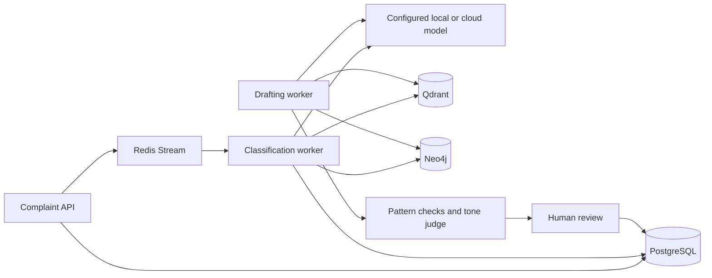

# ResolveAI — Complaint Triage and Review

ResolveAI is a prototype for reviewing consumer financial complaints: prioritize a
queue, inspect similar public cases, generate a draft and review it. It combines a
FastAPI backend, PostgreSQL and a Streamlit interface with optional model inference.

[Hosted demo](https://resolveaideeason.streamlit.app/) ·
[Architecture](docs/architecture.md) · [Product scope](docs/product_scope.md) ·
[Demo walkthrough](docs/demo_script.md)

The demo is for public historical records and synthetic submissions. Hosting
availability, loaded record counts and account roles must be verified against the
deployed revision. A public complaint is an allegation; a company response label
is not proof that the customer's problem was resolved.

## What works, and what the prototype does not prove

The API supports complaint intake, classification, similarity lookup, draft
generation and reviewer approval/rejection. Rejection feedback feeds regeneration.
The dashboard includes triage, case details, aggregates, a graph explorer, logged
model usage and a workspace for staff-triggered batches.

Approval currently sets a case to `resolved`; this records an application decision,
not delivery, remediation or customer satisfaction. Editing the visible draft does
not save a new revision, and approval is not yet bound to the exact visible draft
version. Real customer use requires those review-integrity fixes and verified
recovery. No reviewer-time savings, resolution-rate improvement, production
reliability or legal-correctness result has been established.

## Current pipeline



PostgreSQL stores business records. Qdrant and Neo4j contain derived search/context
information. Redis publication and database commits are currently separate, so
this diagram is not a guarantee of atomic enqueueing or lossless processing.
Worker replay and stale-result handling need further protection.

Local inference requires an installed compatible model. Both production environment
examples set `LLM_SKIP_LOCAL=true`, using cloud inference by default. Total
provider failure now records classification as unavailable, with unknown urgency
for new cases and visible manual-triage work. Prior labels survive failed
reclassification but are marked stale; automatic drafting is blocked. Legacy
provenance stays unknown. [Architecture and limits](docs/architecture.md) explain
these boundaries and the remaining manual-editing and job-reliability work.

## Dashboard

| Page | Current capability |
|---|---|
| Dashboard | Volume, date windows, classification coverage, product/company aggregates |
| Triage Queue | Server-side filtering, ordering and pagination |
| Complaint Detail | Narrative, classification, similar public cases, draft trace, checks and review controls |
| Analytics | Trends and company aggregates with graph-derived scores |
| Graph Explorer | Company/product/issue/reference relationships |
| LLMOps Observatory | Logged usage, estimated cost, latency and violations; incomplete attempt coverage |
| Workspace | Case-state counts and staff batch controls |

## Model experiment and checks

The repository includes QLoRA training, evaluation, GGUF export and Ollama serving
scripts for Qwen2.5-3B-Instruct. The available evaluation splits overlap: 185 of
995 test narratives also occur in training. The historical scores therefore do
not establish generalization. The baseline prompt also omits the complete output
contract, and labels are teacher-generated rather than independently established
gold. [The fine-tuning guide](docs/fine_tuning_guide.md) preserves the historical
numbers, explains the macro-F1 reporting difference, and defines a fair rerun.

Draft checks cover structural keywords, selected prohibited phrases, numeric PII
patterns, citation-title matches and model-scored tone. They do not verify law,
factual support or complete PII removal. Raw narrative/context can reach a cloud
provider before output redaction. Reviewers must inspect the original evidence;
a green check is not a compliance certification.

## Stack

| Component | Role | Development host port |
|---|---|---|
| FastAPI | API, authentication, authorization and rate limits | 8010 |
| PostgreSQL 16 | Business records | 5433 |
| Redis 7 | Streams and token revocation | 6380 |
| Qdrant | 384-dimensional narrative similarity search | 6334 |
| Neo4j 5 + APOC | Seeded relationship/reference graph | 7475 / 7688 |
| Ollama | Optional local model serving | 11435 |
| Streamlit | Reviewer interface | 8511 |

## Local setup

Use Docker Engine/Desktop with Compose v2. Capacity depends on corpus size and
whether local inference is enabled. Use synthetic data initially.

```bash
git clone <repo-url>
cd Resolve_AI
cp .env.example .env
# Set distinct random credentials and JWT secrets before starting.
docker compose up -d
```

The dashboard is at <http://localhost:8511> and API documentation at
<http://localhost:8010/api/docs>. The stack starts empty. Staff and demo access require
explicit account provisioning; public self-registration must not confer staff
privileges. A viewer can inspect records but cannot submit, enqueue or approve. Follow
[account provisioning](docs/access.md) to preview and create the intended staff
and viewer accounts; production registration is disabled by default.

The data scripts are `scripts/download_cfpb_data.py` (public corpus download),
`scripts/populate_vector_db.py` (embeddings), and `graph_seed/seed_graph.py`
(derived graph). Corpus import uses the admin-only bulk-import API. The downloader's
sample limit is a configuration choice, not evidence that a deployment contains or
has processed that many records. Confirm import/rebuild completion before retrying
an interrupted run; the current ingestion path has known batch/restart limits.

Model work requires either a compatible Ollama model or a configured cloud key.
Start the development workers when needed:

```bash
docker compose exec -d api python -m app.workers.classification_worker
docker compose exec -d api python -m app.workers.resolution_worker
```

## Development and deployment

```bash
cd backend
python -m pytest tests/ -v
python -m ruff check . ../frontend ../scripts
python -m ruff format --check . ../frontend ../scripts
```

The dated baseline at commit `0e75774` passed 543 backend tests with 11 warnings on
2026-10-17, using SQLite and injected fakes. This does not establish PostgreSQL
transaction behavior, browser coverage or production readiness. No frontend
AppTest suite was present at that baseline. The current tree adds a separate
PostgreSQL migration/recovery suite and focused frontend-client contract tests;
these are not browser/AppTest coverage. See [testing](docs/testing.md) and
[complete backup recovery](docs/backup_recovery.md) for reproducible commands.

[VM deployment](docs/deployment.md) and [managed deployment](docs/deployment-free.md)
describe the existing configurations and recovery limits. Verify provider terms,
quotas and costs before deploying; no zero-cost or uptime guarantee is made.
The current `v*` tag workflow publishes to hosted infrastructure. Creating a release
tag is a deployment operation, not simply documentation. See [CHANGELOG.md](CHANGELOG.md)
for historical releases.

## Repository layout

- `backend/app/`: API routes, schemas, models, services and stream workers.
- `backend/alembic/`, `backend/tests/`: migrations and verification.
- `frontend/`: Streamlit pages, API client, tour and explanatory notes.
- `fine_tuning/`: labeling, training, evaluation and model export experiments.
- `graph_seed/`: reference seeds and graph-building scripts.
- `scripts/`: data loading, derived-index population and operational helpers.

## Data and next work

Historical records come from the
[CFPB Consumer Complaint Database](https://www.consumerfinance.gov/data-research/consumer-complaints/).
Source redactions and output pattern matching do not guarantee the absence of
personal information. Keep demonstrations limited to public/synthetic inputs.

Priorities are access control, recoverable backups, explicit inference failures,
exact draft review, durable work processing and manual completion. Validate the
[proposed credit-reporting reviewer workflow](docs/product_scope.md) before adding
more infrastructure or claiming business impact.
