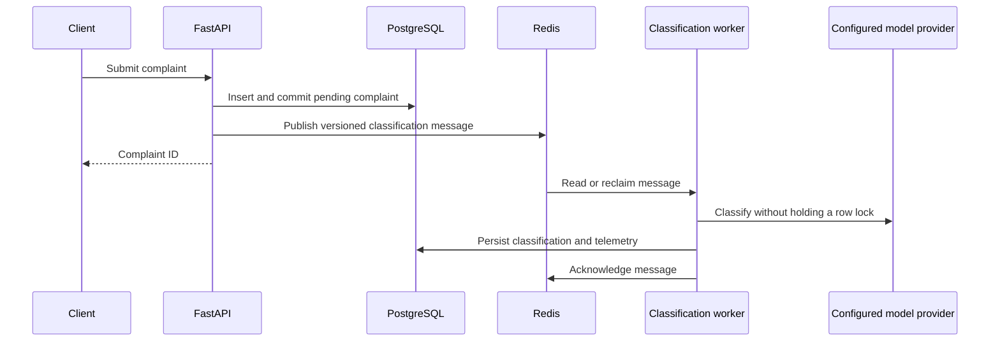

# Architecture

This describes the implementation and its known limits. The initial review was
2026-10-17; access control, classification outcomes, sessions, PostgreSQL verification
and backup handling were revised on 2026-10-18. Proposed queue/review changes are not existing guarantees.

## Runtime topology

| Component | Current role |
|---|---|
| FastAPI | API, authentication, validation and rate limits |
| PostgreSQL | Complaints, users, draft resolutions, labels, telemetry and audit records |
| Redis | Stream queues and refresh-token revocation |
| Qdrant | 384-dimensional narrative embeddings for similarity search |
| Neo4j with APOC | Company/product/issue relationships and seeded reference material |
| Ollama | Optional local inference when a compatible model is installed |
| Streamlit | Reviewer interface; Python makes API requests on the server |

Development Compose includes these services. Production Compose starts the workers
as services and makes Ollama opt-in. The managed hosting configuration runs the API
and both workers in one container under supervisord, with external datastores.
Both production environment examples set `LLM_SKIP_LOCAL=true`: their default
classification path is cloud inference, not the fine-tuned local model.

## State and queue boundary

PostgreSQL is authoritative business storage. Qdrant and Neo4j are derived indexes;
rebuild scripts exist, but rebuild completeness and duration need verification.
Redis Streams use consumer groups and pending-message reclamation. These mechanisms
allow redelivery; they do not make database updates and queue publication atomic.

Publication follows the database commit, leaving a crash window between the two
systems. A lost enqueue can still strand work without a durable job record;
automatic reconciliation is not yet implemented. Versioned messages fence stale
results, but do not guarantee durable delivery or exactly-once external calls.

Synchronous model calls are offloaded with `asyncio.to_thread`. Both workers end
their read transaction before inference and lock/recheck case and input versions
at completion. Classification-triggered drafts remain `escalated` while running;
explicit requests mark `agent_triggered` when scheduled. Worker claims do not
advance versions, so a crashed attempt can retry its message. See
[review concurrency](review_concurrency.md) for invariants and rollout limits.

## Classification and drafting

The classifier uses an installed local model unless local inference is skipped;
otherwise the configured cloud provider is used. When every provider fails, the
classifier returns no labels. The worker persists an independent classification
outcome (`pending`, `succeeded`, `unavailable`, `manual`, or `legacy_unknown`) plus
source, staleness, attempt time, elapsed latency, and safe error category. Existing
rows receive unknown provenance during migration; their labels remain unchanged.

A new unavailable case moves to `needs_review` with null urgency/priority. Failed
reclassification retains prior labels/source, marks them stale and preserves its
existing lifecycle. Neither path starts drafting or updates derived indexes.
Generation and regeneration reject unavailable/stale inputs. Successful fallback
records the actual provider and fallback flag. Task latency includes all attempts.

The classification worker skips terminal/manual-source cases. Both workers reject
stale case/input versions before inference and when persisting results. Durable
job identity and leases remain unfinished. The UI exposes a Needs triage filter
and provenance notices; saved manual label editing remains separate work.
See [classification rollout](classification.md) for classification provenance.

The resolution agent uses a bounded flow: gather context, draft, validate,
regenerate with feedback, then return a draft or escalate after the retry limit.
Context gathering tolerates tool errors, so a completed draft can lack a source.
Rejection feedback enters the regeneration prompt. The stored trace describes
tool calls and workflow steps; it is not access to a model's private reasoning.

## Checks and human review

| Check | What it checks | What it does not establish |
|---|---|---|
| Structure | Length and acknowledgment/next-step keywords | A correct or useful response |
| Content patterns | Selected prohibited wording and numeric PII patterns in output | Complete PII removal or protection of cloud-bound inputs |
| Citation matching | Title substrings in a separate citation list against retrieved titles | Correct law, supported prose, jurisdiction or applicability |
| Tone judge | Model scores for empathy, professionalism and actionability | Factual or legal accuracy |

The tone judge runs only after deterministic checks pass. Unreachable judging
produces a violation, but the current UI can show an unrun layer as passed.
The agent constructor has a pass-through validator default; production workers
explicitly inject the real engine. A completed check is a limited signal for
human review, not a compliance certification.

Approval requires the exact saved draft ID and displayed case version. A short
case lock serializes decisions, while an immutable review event binds the reviewer
to the text hash. Rejected drafts cannot later be approved. The displayed draft is
read-only; saved human edits remain a separate workflow. New approvals use
`response_approved`, with delivery and customer outcome unrecorded. Legacy
`resolved` rows retain explicit unknown-outcome markers. See
[product scope](product_scope.md) for the outcome boundary.

## Authentication and API conventions

JWT access tokens travel in the Authorization header. Refresh tokens use an
httpOnly cookie in Streamlit's per-session HTTP client; the browser does not call
the API directly. Database role checks, not hidden controls, must authorize writes.
Public registration is disabled by default outside development/test; when enabled
it creates viewers. The configured demo identity is rejected if it is privileged.
Staff provisioning is an explicit administrative operation; see [access](access.md).
Refresh tokens carry random session IDs and a credential fingerprint. One atomic
Redis SET NX consumes each token until its original expiry. Password changes
invalidate existing refresh credentials; issued access tokens remain valid until
expiry unless the account is disabled. Legacy refresh tokens require a new login.
Production Compose routes Streamlit requests through Caddy's private HTTPS listener
so Secure cookies work with verified TLS; no public API route is added.

Bcrypt inputs are bounded at 72 UTF-8 bytes for hashing and verification. Async
handlers offload bcrypt work and enforce an account ceiling in addition to the
endpoint ceiling. Redis uncertainty fails authentication closed. The existing
aggregate limiter still uses synchronous Redis I/O with bounded socket timeouts;
this remains a performance limit during a slow Redis response.

Wire contracts use Pydantic schemas separately from SQLModel rows. Queue endpoints
filter/order/page in SQL and send narrative previews; detail endpoints load the
full case. Several charts use database aggregates. Other observability endpoints
load unbounded rows into Python, and the analytics page makes serial graph calls;
these need workload measurements and query limits before scale claims.

## Telemetry and verification

Workers persist model/provider/token/latency/cost fields with some business writes.
This is not a complete provider-call ledger: failed attempts, historical labels,
unknown pricing and historical zero-duration fallback records limit interpretation.
New classification outages use `classify_unavailable`, elapsed task latency and
null usage/cost, so they do not count as successful classifications in drift
sampling. Some aggregate cost endpoints still coalesce unknown cost to zero. Recorded
cost is an estimate for logged calls, not the cost of the corpus or total operation.

The 2026-10-17 baseline verification at commit `0e75774` passed 543 backend tests
with 11 warnings. These use SQLite and injected provider/store/Redis fakes. They do
not prove PostgreSQL migrations, transaction races, deployment readiness or browser
behavior. No Streamlit AppTest suite was present at that baseline. Use the current
test output for later revisions rather than treating this dated count as a gate.

## Recovery and database checks

Complete version 2 exports include all application tables in one PostgreSQL
read-only snapshot. Restore requires a matching migrated schema and empty target,
verifies files and relationships, and commits all rows together. See
[backup recovery](backup_recovery.md). Legacy partial exports remain incomplete.

The current [test foundation](testing.md) adds PostgreSQL migration, constraint,
transaction-visibility, concurrency and default-restore checks. Client contract
tests cover demo access behavior; there is still no browser/AppTest coverage.
